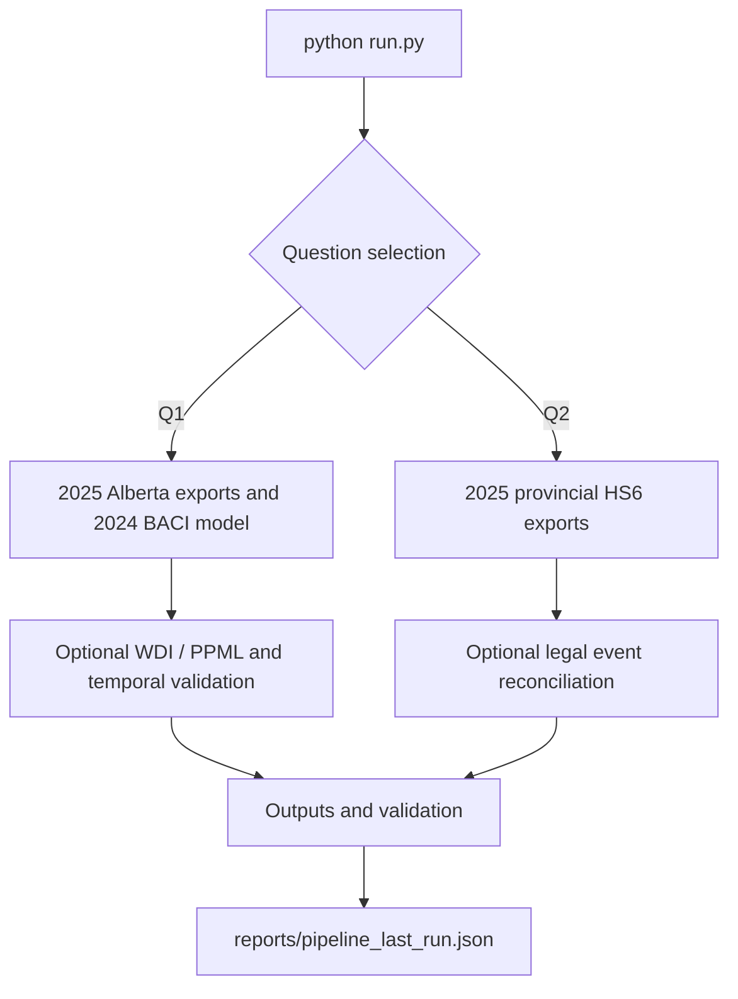

# Standard pipeline entry point

```bash
python run.py --help
python run.py --dry-run
python run.py                           # Q1 then Q2
python run.py --question q1            # Q1 only
python run.py --question q2 --legal-audit  # Q2 and legal event reconciliation
python run.py --extended --new-sources --legal-audit --tests
python run.py --continue-on-error --legal-audit
```

The optional `--extended` and `--new-sources` steps may require original Q1 raw archives not present in the clean repository. Stage failures are recorded in `reports/pipeline_last_run.json` and return a nonzero exit status. `--continue-on-error` allows other stages to run but does not hide errors. The dry run does not modify data.

## Execution flow



